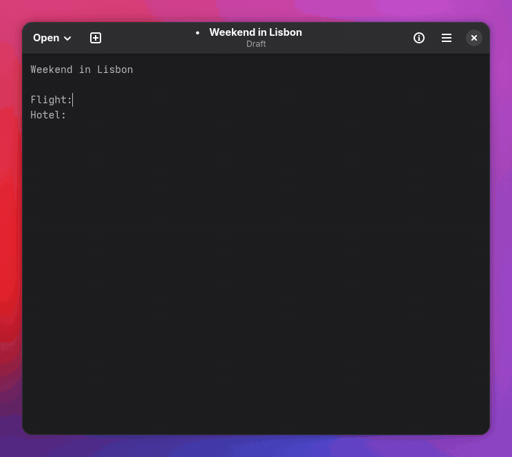
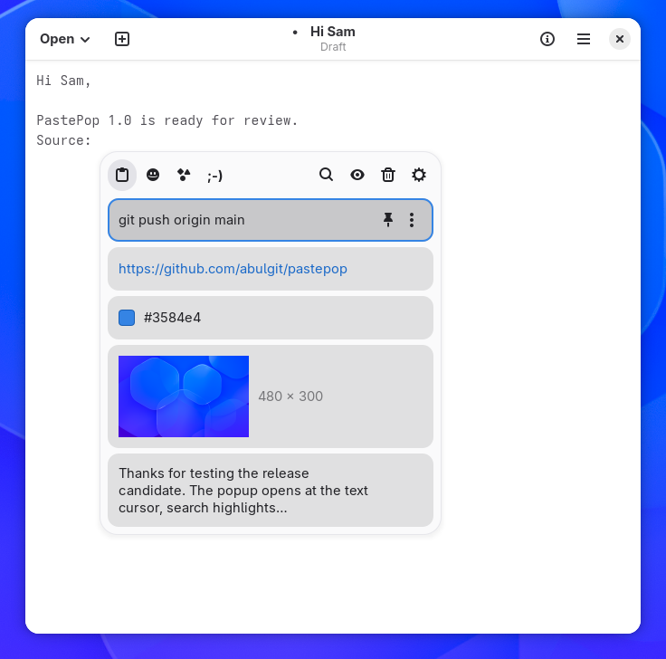
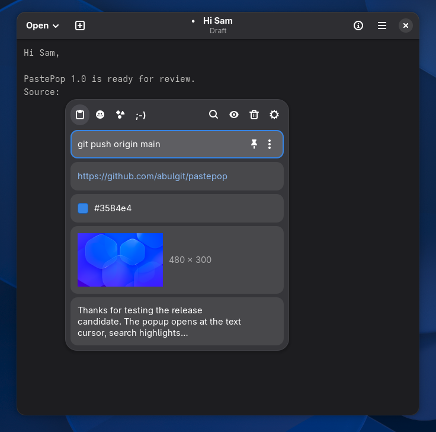
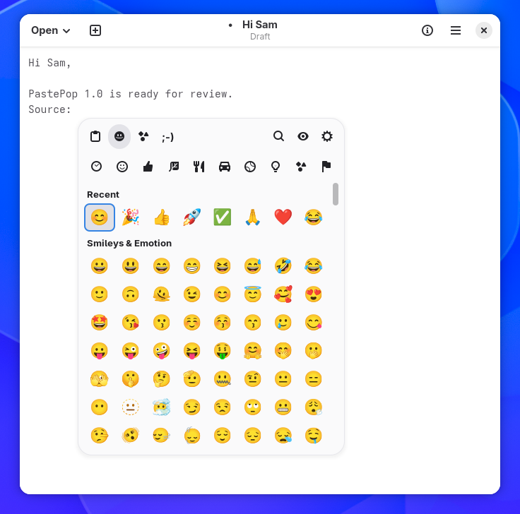
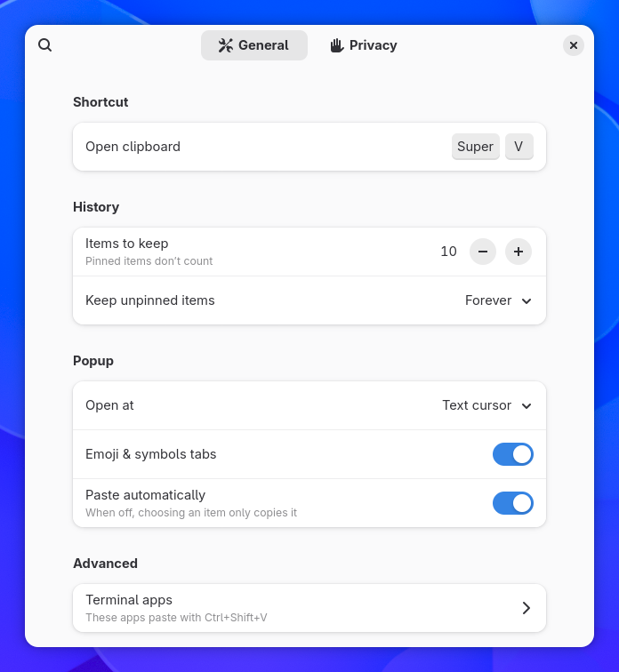

# PastePop

Clipboard history for GNOME, like Windows' Win+V.

[Get it on GNOME Extensions](https://extensions.gnome.org/extension/0000/pastepop/) <!-- TODO: EGO id once approved -->

Press your shortcut and a small popup opens at the text cursor with what you
copied recently. Pick an item and PastePop pastes it into the app you were
using. It looks like the rest of GNOME Shell, needs nothing else installed,
never goes online, and leaves the clipboard alone until you pick an item.



## Features

- Text, images and copied files, kept across restarts
- Search by typing; matches are shown in bold
- Pin items; delete one or all, with undo
- Paste as plain text, or copy without pasting
- Emoji, symbols and kaomoji tabs
- Colour swatches for colour codes, previews for images
- Private mode and excluded apps; copies marked by password managers are never kept

 
 

## Shortcuts

| Key | Action |
|---|---|
| Your shortcut, e.g. Super+V | Open or close the popup |
| Up, Down, Page Up, Page Down | Move the selection |
| Enter or click | Paste |
| Shift+Enter | Paste as plain text |
| Ctrl+Enter | Copy without pasting |
| Ctrl+1 to Ctrl+9 | Paste one of the first nine items |
| Ctrl+P | Pin or unpin |
| Delete | Delete |
| Ctrl+Z | Undo Delete or Clear all |
| Ctrl+F, or start typing | Search |
| Menu or Shift+F10 | Item menu |
| Ctrl+Tab | Next tab |
| Esc | Clear the search, then close |

Drag the popup by its header to move it. The ⚙ button in the header opens Settings.

## Install

Install it from [extensions.gnome.org](https://extensions.gnome.org/extension/0000/pastepop/) <!-- TODO: EGO id -->
or with Extension Manager. It needs GNOME 50 or 51. Turn off any other
clipboard manager first.

To install by hand, download `pastepop@abulgit.shell-extension.zip` from
[Releases](https://github.com/abulgit/pastepop/releases) and run:

```sh
gnome-extensions install --force pastepop@abulgit.shell-extension.zip
```

Log out and back in, since GNOME only loads new extensions at login on Wayland.
Then run `gnome-extensions enable pastepop@abulgit`.

## First run

PastePop has no shortcut by default. When you first enable it, a notification
offers one: click **Use Super+V**, or **Choose…** to set another in Settings →
Open clipboard.

GNOME also opens the notification list with Super+V. While Super+V is
PastePop's shortcut, the notification list uses Super+M only. Nothing is written
to GNOME's settings: choose another shortcut or turn PastePop off and Super+V
opens notifications again.

## Privacy and data

- History is kept only on this computer, in `~/.local/share/pastepop/`. Only
  you can read the files (mode 0600).
- Copies that password managers mark as secret are never stored.
- Private mode stops recording. Turn it on and off in the popup or in
  Settings → Privacy.
- Nothing you copy in an excluded app is recorded. Pick the apps in
  Settings → Privacy → Excluded apps.
- Unpinned items can be kept forever, until restart, or for an hour, a day or a
  week.
- PastePop makes no network requests. A link opens only when you choose
  **Open link**.
- **Clear all** in the popup deletes everything except pinned items.

## Troubleshooting

**Nothing is pasted.** The item is still on the clipboard, so Ctrl+V works.
PastePop pastes with Shift+Insert, or with Ctrl+Shift+V in terminals. If your
terminal isn't recognised, add it under Settings → General → Terminal apps.

**The popup opens in the wrong place.** Some apps, such as X11 apps running
through XWayland, don't report their text cursor. PastePop then opens at the pointer if it is over
the window, or in the middle of the screen. **Open at** in Settings changes this.

**Logs.** Include the output of this in a
[bug report](https://github.com/abulgit/pastepop/issues/new?template=bug_report.yml):

```sh
journalctl -b -o cat /usr/bin/gnome-shell | grep -i pastepop
```

## Development

You need Node.js 22.18 or newer, `gnome-extensions` (part of gnome-shell) and
gettext.

```sh
npm ci
npm run build    # compile to dist/
npm run lint
npm test         # unit tests for src/core
npm run pot      # update po/pastepop.pot
npm run pack     # build pastepop@abulgit.shell-extension.zip
npm run deploy   # pack, install and enable in your session
```

To try a build without touching your session, run a shell with its own data and
settings. For a window, install the devkit (`sudo dnf install mutter-devkit`):

```sh
export XDG_DATA_HOME=$(mktemp -d) XDG_CONFIG_HOME=$(mktemp -d)
mkdir -p "$XDG_DATA_HOME/gnome-shell/extensions"
cp -r dist "$XDG_DATA_HOME/gnome-shell/extensions/pastepop@abulgit"
dbus-run-session -- sh -c 'gnome-shell --devkit --wayland & sleep 5; gnome-extensions enable pastepop@abulgit; wait'
```

For scripted tests, use `--headless --virtual-monitor 1280x800` instead of
`--devkit`.

Pushing a `v*` tag builds the zip and attaches it to a GitHub release.

## License

[GPL-2.0-or-later](LICENSE)
