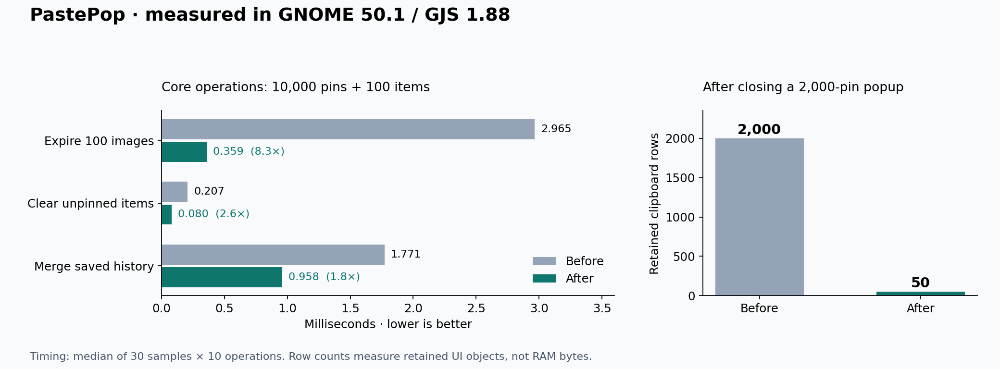
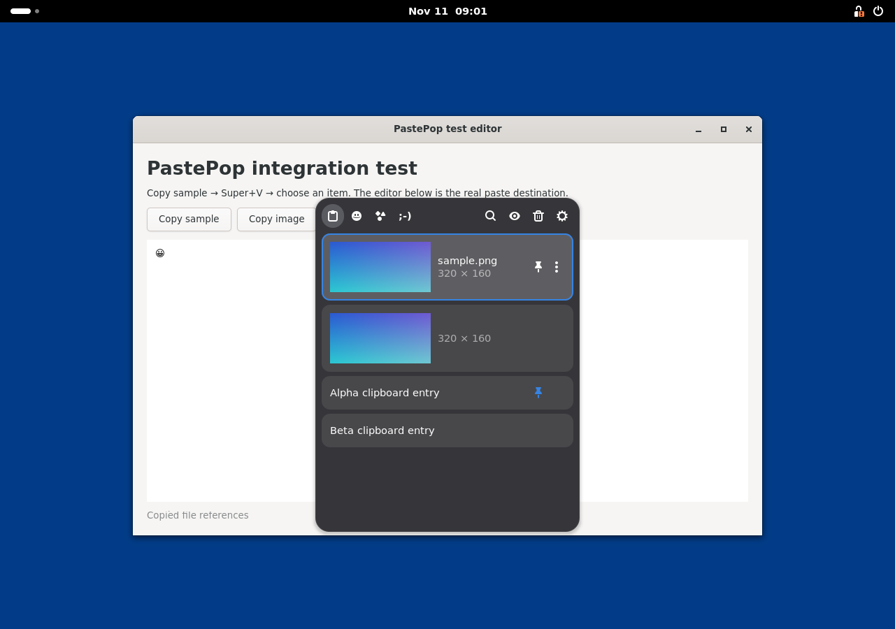

# Stability and performance testing

Baseline: `30a50aa` on `main`. Tests used synthetic clipboard content in an
isolated Ubuntu 26.04 container, GNOME Shell/Mutter 50.1, GJS 1.88, and a
1280×900 headless Wayland session with software rendering. The test desktop
used a mock logind service; no test-specific source edits or metadata overrides
were applied to either revision.
Node 24.22.1 ran the TypeScript tests.

## Changes

- Reduce repeated history scans during clearing, expiry, and blob cleanup.
- Release expanded clipboard rows when closing the popup, retaining the first
  50. Normal-sized histories avoid an extra refresh.
- Cancel a pending clipboard read when private mode is enabled, retaining the
  rejection across Mutter's memory-source fallback.
- Preserve long text whose first 4 KiB is whitespace; deduplicate saved history
  and avoid the argument-count limit when loading many pins.
- Enforce the history limit immediately on unpin and reject corrupt index
  timestamps and dimensions.

No dependencies, runtime limits, or user settings defaults changed.

## Results



The primary benchmark ran each revision in a separate GJS process: five warmup
samples, then the median of 30 samples, each containing ten operations. Input
construction and forced GC were outside the timer. Blob deletion callbacks were
no-ops: these are **core algorithm timings**, not disk I/O or complete popup
latencies. All 36 scenarios and native UI results are in
[results.json](testing/results.json).

With 10,000 pinned items and 100 unpinned items:

| Operation | Before | After |
| --- | ---: | ---: |
| Expire 100 image entries | 2.965 ms | 0.359 ms |
| Clear unpinned entries | 0.207 ms | 0.080 ms |
| Merge saved history after ten new copies | 1.771 ms | 0.958 ms |
| Add text and evict one image | 0.239 ms | 0.285 ms |
| Prune without changes | 0.021 ms | 0.033 ms |
| Load into empty history | 0.333 ms | 0.486 ms |

The largest improvement is bulk expiry, about 8× in both the separate-process
and paired runs. This is not a universal speedup. Deduplicating input costs
time on empty loads; adding one item also regressed slightly at this stress
size. No-op pruning varied between runs (0.021→0.021 ms in the paired run).
The normal unpinned limit is at most 100; these stress cases exercise the
unlimited pin count, not a newly increased history limit.

### Memory and UI objects

After opening 2,000 pinned text entries, pressing End, and closing:

| Measurement | Before | After |
| --- | ---: | ---: |
| Retained clipboard rows | 2,000 | 50 |
| Actors attached to the whole stage | 26,131 | 2,729 |
| Whole-shell PSS after close and forced GC | 568.9 MiB | 578.4 MiB |

The row retention issue is fixed. **A reduction in whole-shell RAM was not
demonstrated.** Native allocator/rendering caches kept memory high even after
row destruction. Twenty subsequent open/close cycles retained 50 rows in both
versions; the baseline released its extra rows on reopening. End still builds
the entire history while open, so peak rendering cost remains a candidate for
a separate, more substantial virtualization change. Visited symbol cells also
remain cached until the extension is disabled.

### Functional and privacy checks

- All 27 core tests, type checking, lint, and build passed. Five regression
  tests were added and corrupt-index validation tests extended.
- A deterministic stress harness completed 200,000 mixed operations per
  revision: add, pin, unpin, remove, undo, clear, purge, load, and limit changes.
  After normalizing pruning, history ordering, pin state, and deletion events
  matched; referenced blobs were not deleted.
- The native GUI suite passed 33 baseline checks and 34 candidate checks
  (including app-control readiness checks). It exercised Super+V, real pointer
  clicks on extension buttons, search, pin/delete/undo, Clear/Undo, copy-only,
  automatic paste into a GTK4 editor, private mode, password hints, PNG capture,
  file-path plain-text paste, emoji insertion, all symbol tabs, and twenty
  open/close cycles. The additional candidate assertion checks row release.
- The Settings button opened the actual libadwaita preferences window in both
  revisions. Saved pins loaded after restarting the candidate Shell session.
- A native GTK clipboard provider delayed delivery by one second. Private mode
  was enabled about 105 ms after the baseline transfer started and 108 ms after
  the candidate transfer started. The baseline recorded the text while private;
  the candidate did not. Turning private mode off did not revive the read.
- Five additional candidate checks passed: excluded-app filtering, cancellation
  of a stale transfer after a newer copy, exact pasting of long text with a
  blank prefix, rejection of text above 4 MiB, and restoring PNG clipboard
  bytes with an identical SHA-256 digest.
- Packaging the compiled extension with the repository's `gnome-extensions pack`
  arguments succeeded; all 28 archive entries passed CRC validation.

The GUI harness used test-only Shell D-Bus evaluation for inspection, virtual
input devices for pointer/keyboard events, and Shell's native screenshot API.
Initial harness runs exposed an invalid search expectation and a virtual pointer
initialization issue; these were corrected before the completed runs above.



## Security review and limits

The confirmed privacy timing bug is fixed. Blob paths remain validated, markup
is escaped, history files use private permissions, and capture has size limits.
This was a source review and targeted regression exercise, not a comprehensive
security certification.

`npm audit` reported 11 moderate dev-toolchain findings, all stemming from
[minimatch GHSA-g3hv-75wg-m249](https://github.com/advisories/GHSA-g3hv-75wg-m249),
with no high or critical findings. No complete fix was reported for the current
direct dependency combination. These packages are not shipped in the extension;
the lockfile was left unchanged.

GNOME 51, Fedora-specific integration, GPU rendering, X11/terminal pasting,
lock/logout, and prolonged daily usage were not validated. File history stores
references rather than file backups; text beyond its 4 KiB preview is not
searched. Those existing behaviors were left unchanged.

## Reproduce core timings

Run from the existing checkout with Node 24, GJS, and GLib tools installed:

```sh
npm ci
npm run lint
npm test
npm run build
npx tsc -p tsconfig.test.json --noEmit false --outDir /tmp/pastepop-benchmark
gjs -m /tmp/pastepop-benchmark/scripts/benchmark.js "$PWD/dist/core/history.js"
```

To measure the original core without changing the checkout:

```sh
mkdir -p /tmp/pastepop-before
git archive 30a50aa src/core | tar -x -C /tmp/pastepop-before
npx tsc --ignoreConfig --strict --target ES2023 --module ESNext \
  --moduleResolution Bundler --rewriteRelativeImportExtensions \
  --outDir /tmp/pastepop-before-js /tmp/pastepop-before/src/core/history.ts
gjs -m /tmp/pastepop-benchmark/scripts/benchmark.js /tmp/pastepop-before-js/history.js
```

For a local GUI smoke test, build/package and install in a disposable GNOME
50/51 user session. Verify copy→Super+V→paste, search, pin, delete/undo,
Clear/Undo, privacy filters, images/files, and symbols. To inspect row retention,
use a large pinned history, press End, close the popup, and compare actor counts
or heap snapshots before and after. Keep test history separate from personal
clipboard data.
